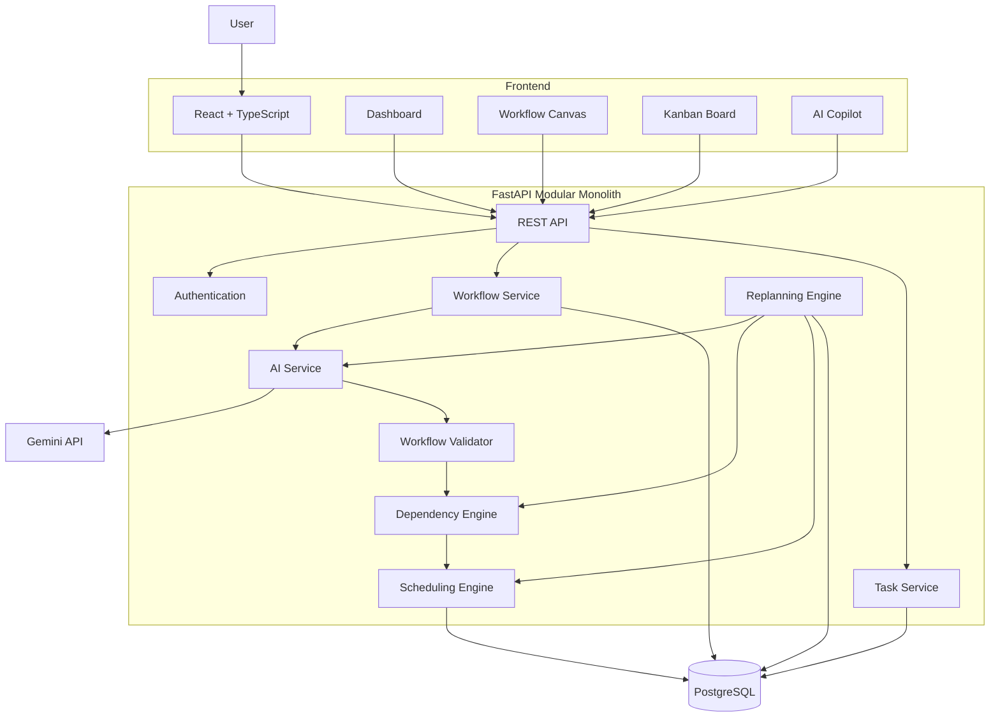
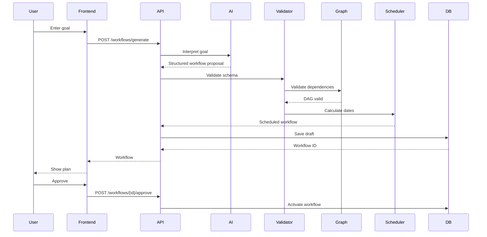
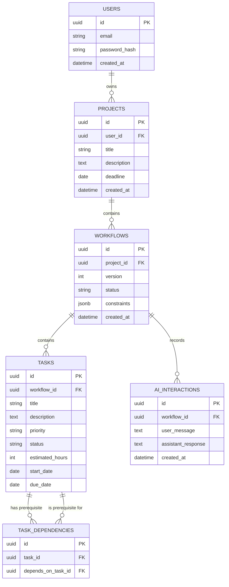

# FlowPilot — AI That Converts Messy Requests Into Executable Workflows

> **Project type:** AI-powered full-stack workflow orchestration platform  
> **Scope:** Medium, portfolio/resume-ready MVP  
> **Target build time:** 3–4 weeks for a solo developer  
> **Architecture:** Modular monolith  
> **Primary stack:** React + TypeScript, FastAPI + Python, PostgreSQL, Gemini API  
> **Core idea:** Convert an unstructured human goal into a structured, dependency-aware, schedulable, trackable workflow and dynamically replan it when reality changes.

---

# 1. Executive Summary

FlowPilot is an AI-powered workflow planning and orchestration platform.

Most productivity/project-management tools expect users to manually create tasks, arrange priorities, define dependencies, and create schedules. FlowPilot reverses that interaction.

Instead of asking:

> "What tasks do you want to create?"

FlowPilot asks:

> "What are you trying to accomplish?"

A user can enter a messy natural-language request such as:

> "I want to build an AI resume analyzer in 21 days. I know Python and React, I'm working alone, and I want to deploy it before the end of the month."

FlowPilot analyzes the request and produces:

- A project goal
- Phases
- Tasks and subtasks
- Priorities
- Estimated durations
- Dependencies
- Proposed schedule
- Progress tracking
- Potential blockers
- A workflow graph

If something changes, the user can say:

> "Backend development is delayed by 3 days."

FlowPilot identifies affected downstream tasks and generates a revised plan.

The key distinction is that FlowPilot is **not simply a chatbot that gives a list of suggestions**. It is a system where AI generates structured planning information, while deterministic software validates, stores, schedules, visualizes, and tracks that plan.

---

# 2. One-Line Product Definition

> **FlowPilot converts vague human goals into structured, dependency-aware, executable workflows and continuously adapts those workflows as circumstances change.**

---

# 3. Product Vision

## Vision

Make planning as simple as describing the outcome.

The user should not need to understand project management concepts such as:

- task decomposition
- dependencies
- prioritization
- scheduling
- critical paths
- workflow states

They describe what they want to achieve.

FlowPilot handles the planning structure.

## Product loop

```text
Human Intent
     ↓
Understand
     ↓
Decompose
     ↓
Structure
     ↓
Validate
     ↓
Schedule
     ↓
Execute
     ↓
Track
     ↓
Detect Change
     ↓
Replan
     ↓
Execute Again
```

---

# 4. Problem Statement

People frequently know the outcome they want but do not know how to translate that outcome into an executable plan.

Examples:

- "I need to prepare for five exams in 20 days."
- "I need to build an MVP in one month."
- "I need to organize a college hackathon."
- "I need to migrate our backend to PostgreSQL."
- "I need to launch an online store."
- "I need to prepare a technical event for 150 students."

Traditional task managers generally require users to manually:

1. Create tasks.
2. Break large tasks into smaller tasks.
3. Set priorities.
4. Set deadlines.
5. Define dependencies.
6. Rearrange tasks when something is delayed.

The cognitive work happens before the project-management software can become useful.

## Problem FlowPilot addresses

```text
Messy Goal
    ↓
Planning Complexity
    ↓
Task Decomposition
    ↓
Dependency Identification
    ↓
Scheduling
    ↓
Execution
    ↓
Unexpected Changes
    ↓
Manual Replanning
```

FlowPilot attempts to automate the planning and replanning portion of this process.

---

# 5. Why Build FlowPilot?

FlowPilot is valuable as a portfolio project because it combines several engineering domains in one coherent product.

## 5.1 AI engineering

The application must transform natural language into structured data rather than simply displaying an LLM response.

## 5.2 Backend engineering

The backend manages:

- users
- projects
- workflows
- tasks
- dependencies
- versions
- status transitions
- AI interactions

## 5.3 Algorithms

The project contains real algorithmic components:

- Directed Acyclic Graphs
- topological sorting
- cycle detection
- dependency traversal
- scheduling
- progress calculations
- replanning

## 5.4 Full-stack engineering

The project contains:

- React frontend
- REST API
- database
- AI service
- authentication
- deployment

## 5.5 Product engineering

The system has a clear user-facing workflow rather than being an isolated technical demo.

---

# 6. Target Users

## Primary users

### 1. Students

Examples:

- exam preparation
- semester project planning
- internship preparation
- hackathon organization

### 2. Developers

Examples:

- personal software projects
- MVP development
- migration planning
- release planning

### 3. Startup founders

Examples:

- product launches
- MVP planning
- marketing campaigns
- operational planning

### 4. Individuals

Examples:

- event planning
- personal projects
- learning plans
- complex goals

---

# 7. Core Use Cases

## Use Case 1 — Software Project

Input:

> "Build a food delivery MVP in four weeks."

FlowPilot creates:

```text
Food Delivery MVP
│
├── Requirements
│   ├── Define MVP scope
│   ├── Define user roles
│   └── Define API requirements
│
├── Backend
│   ├── Database schema
│   ├── Authentication
│   ├── Restaurant APIs
│   ├── Cart APIs
│   └── Order APIs
│
├── Frontend
│   ├── Restaurant UI
│   ├── Cart UI
│   └── Order UI
│
└── Testing & Deployment
    ├── Integration testing
    ├── Bug fixing
    └── Deployment
```

---

## Use Case 2 — College Event

Input:

> "Organize a 24-hour hackathon for 150 students in 30 days with a ₹50,000 budget."

FlowPilot can identify:

- venue
- registration
- sponsorship
- marketing
- mentors
- judges
- food
- prizes
- technical infrastructure
- event-day operations

It can also identify dependencies.

Example:

```text
Venue confirmation
       ↓
Registration launch
       ↓
Participant onboarding
```

---

## Use Case 3 — Exam Preparation

Input:

> "I have five subjects and 20 days to prepare. I want to revise theory and practice questions."

FlowPilot can generate:

- subjects
- topics
- revision blocks
- practice tasks
- review tasks
- deadlines

The user can later say:

> "I missed yesterday's study plan."

The replanning engine can adjust remaining work.

---

## Use Case 4 — Project Replanning

Initial plan:

```text
Backend
 ↓
API Integration
 ↓
Testing
 ↓
Deployment
```

User reports:

> "Backend is delayed by 3 days."

FlowPilot identifies downstream tasks and proposes a new schedule.

---

# 8. Product Differentiation

FlowPilot should not be positioned as:

> "An AI to-do list generator."

The stronger positioning is:

> "An AI workflow planning and replanning engine."

The important technical distinction is the combination of:

1. Natural-language goal understanding
2. Structured task generation
3. Dependency graph creation
4. Deterministic graph validation
5. Schedule generation
6. Persistent workflow state
7. Dynamic replanning

The LLM handles ambiguity and language.

The backend handles correctness and state.

---

# 9. MVP Definition

The MVP should prove the central product loop.

## MVP features

- Natural-language goal input
- AI goal interpretation
- AI task decomposition
- Task and subtask generation
- Priority generation
- Estimated duration
- Dependency generation
- Dependency validation
- Cycle detection
- Basic scheduling
- Project persistence
- Task status tracking
- Kanban board
- Workflow graph
- Progress calculation
- AI-assisted replanning
- Workflow versioning
- Basic authentication
- Deployment

---

# 10. Features Explicitly Out of MVP

Avoid scope creep.

The first version should NOT require:

- Slack integration
- Jira integration
- Google Calendar integration
- Microsoft Teams integration
- autonomous email sending
- autonomous external actions
- voice assistant
- multi-agent architecture
- custom model training
- vector database
- complex RAG
- subscription billing
- enterprise permissions
- advanced team collaboration

These can become future versions.

---

# 11. Functional Requirements

## FR-01 — User Authentication

Users should be able to:

- register
- log in
- receive an authenticated session
- access only their own projects

---

## FR-02 — Project Creation

A user can provide:

- project goal
- optional deadline
- optional constraints
- optional skills/resources
- optional team size

---

## FR-03 — AI Workflow Generation

The system should generate:

- project title
- project summary
- phases
- tasks
- subtasks
- priorities
- estimated duration
- dependencies

---

## FR-04 — Workflow Validation

The backend must validate:

- required fields
- valid task references
- dependency references
- duplicate IDs
- cycles
- invalid durations
- invalid priorities

---

## FR-05 — Workflow Persistence

The generated workflow must be saved in PostgreSQL.

---

## FR-06 — Task Management

Users can:

- view tasks
- update status
- edit title
- edit description
- modify priority
- modify dates
- mark tasks complete

---

## FR-07 — Dependency Visualization

Users can see:

```text
Task A → Task B → Task C
```

in a visual workflow canvas.

---

## FR-08 — Replanning

A user can report a change.

Example:

> "Task B is delayed by 3 days."

The system should:

1. Identify Task B.
2. Find dependent tasks.
3. Recalculate affected dates.
4. Preserve completed tasks.
5. Generate a proposed revised workflow.
6. Allow user approval.

---

## FR-09 — Progress Tracking

The system should calculate:

- completed tasks
- remaining tasks
- percentage completion
- overdue tasks
- blocked tasks

---

# 12. Non-Functional Requirements

## Performance

Normal CRUD operations should be fast.

AI generation will naturally take longer because it depends on model response latency.

## Reliability

Invalid AI output must never be blindly persisted.

## Security

- passwords must never be stored as plain text
- authentication tokens must be protected
- users must only access their own data
- secrets must be stored in environment variables

## Maintainability

The backend should separate:

- API layer
- business logic
- AI service
- graph engine
- scheduling engine
- database layer

## Scalability

The MVP can use a modular monolith.

The architecture should leave room for extracting heavy services later.

---

# 13. High-Level Architecture



---

# 14. Architectural Principle

## The LLM is NOT the source of truth.

The LLM is responsible for:

- interpreting natural language
- proposing tasks
- proposing dependencies
- generating summaries
- suggesting replans

The backend is responsible for:

- validation
- authorization
- database state
- dependency correctness
- cycle detection
- scheduling rules
- status transitions

This separation is one of the most important design decisions in FlowPilot.

```text
                 AI
                  │
             Proposed Plan
                  ↓
          Pydantic Validation
                  ↓
        Business Rule Validation
                  ↓
          Dependency Validation
                  ↓
           Graph Validation
                  ↓
           Scheduling Engine
                  ↓
             PostgreSQL
```

---

# 15. Architecture Style

## Modular Monolith

For the MVP, use one FastAPI backend but organize it into independent modules.

```text
FastAPI Application
│
├── Authentication Module
├── Project Module
├── Workflow Module
├── Task Module
├── AI Module
├── Dependency Module
├── Scheduling Module
└── Replanning Module
```

### Why not microservices?

Microservices would add:

- multiple deployments
- service-to-service networking
- distributed debugging
- additional infrastructure
- more configuration

For a 3–4 week solo project, this is unnecessary.

A modular monolith gives most of the organizational benefits without the operational complexity.

---

# 16. End-to-End Workflow



---

# 17. AI Processing Pipeline

The AI pipeline should have multiple stages.

```text
Raw User Request
       ↓
Goal Extraction
       ↓
Constraint Extraction
       ↓
Task Decomposition
       ↓
Dependency Proposal
       ↓
Structured JSON
       ↓
Pydantic Validation
       ↓
Business Validation
       ↓
Graph Validation
       ↓
Scheduling
       ↓
Database
```

---

# 18. Goal Interpreter

Input:

```text
Build an AI resume analyzer in 21 days.
I know Python and React.
I'm working alone.
```

Expected interpretation:

```json
{
  "goal": "Build an AI resume analyzer",
  "deadline_days": 21,
  "team_size": 1,
  "skills": [
    "Python",
    "React"
  ],
  "constraints": [
    "Solo developer",
    "21 day deadline"
  ]
}
```

---

# 19. Structured AI Output

Do not ask the model to return arbitrary prose.

The model should return a predictable structure.

Example:

```json
{
  "title": "AI Resume Analyzer",
  "summary": "Build and deploy an AI-powered resume analysis application.",
  "tasks": [
    {
      "temp_id": "T1",
      "title": "Define MVP requirements",
      "description": "Define supported resume analysis features.",
      "priority": "high",
      "estimated_hours": 4,
      "depends_on": []
    },
    {
      "temp_id": "T2",
      "title": "Design database schema",
      "description": "Create the initial relational data model.",
      "priority": "high",
      "estimated_hours": 4,
      "depends_on": ["T1"]
    }
  ]
}
```

---

# 20. Pydantic Schema

Example conceptual schema:

```python
from typing import Literal
from pydantic import BaseModel, Field


class TaskPlan(BaseModel):
    temp_id: str
    title: str
    description: str
    priority: Literal[
        "low",
        "medium",
        "high",
        "critical"
    ]
    estimated_hours: int = Field(
        gt=0,
        le=1000
    )
    depends_on: list[str] = []


class WorkflowPlan(BaseModel):
    title: str
    summary: str
    tasks: list[TaskPlan]
```

The actual implementation can refine these constraints.

---

# 21. Why Temporary Task IDs?

The AI should not generate actual PostgreSQL UUIDs.

Instead:

```text
AI
 ↓
T1
T2
T3
 ↓
Backend maps:
T1 → UUID A
T2 → UUID B
T3 → UUID C
```

This keeps the database identifiers under backend control.

---

# 22. Dependency Graph

The workflow is modeled as a directed graph.

Example:

```text
Requirements
     ↓
Architecture
     ↓
Database
     ↓
Backend API
     ↓
Frontend Integration
     ↓
Testing
     ↓
Deployment
```

Each task is a node.

Each dependency is a directed edge.

```text
A → B
```

means:

> A must be completed before B can begin.

---

# 23. DAG Requirement

The workflow dependency graph should be a **Directed Acyclic Graph**.

A cycle such as:

```text
A → B
↑   ↓
└───C
```

is invalid because there is no possible starting order.

---

# 24. Cycle Detection

Use topological sorting.

### Kahn's Algorithm

```python
from collections import deque


def topological_sort(graph):
    indegree = {
        node: 0
        for node in graph
    }

    for node in graph:
        for neighbor in graph[node]:
            indegree[neighbor] += 1

    queue = deque(
        node
        for node in indegree
        if indegree[node] == 0
    )

    order = []

    while queue:
        node = queue.popleft()
        order.append(node)

        for neighbor in graph[node]:
            indegree[neighbor] -= 1

            if indegree[neighbor] == 0:
                queue.append(neighbor)

    if len(order) != len(graph):
        raise ValueError(
            "Dependency cycle detected"
        )

    return order
```

### Complexity

For V tasks and E dependencies:

```text
Time:  O(V + E)
Space: O(V)
```

---

# 25. Scheduling Engine

The MVP can use deterministic scheduling.

For a task with no dependencies:

```text
start = project_start
```

For a task with dependencies:

```text
start =
max(finish date of all dependencies)
```

Mathematically:

```text
ES(v) = max(EF(p1), EF(p2), ..., EF(pk))

EF(v) = ES(v) + Duration(v)
```

Where:

- ES = earliest start
- EF = earliest finish
- p = prerequisite

---

# 26. Scheduling Example

Suppose:

```text
A = 2 days
B = 3 days
C = 2 days
```

Dependencies:

```text
A → C
B → C
```

Schedule:

```text
A: Day 1–2
B: Day 1–3
C: Day 4–5
```

C cannot start on Day 3 because B is still running.

The scheduler uses the maximum prerequisite finish time.

---

# 27. Replanning Engine

Replanning is one of FlowPilot's strongest features.

Example:

Initial:

```text
Backend
  ↓
API Integration
  ↓
Testing
  ↓
Deployment
```

User:

> Backend is delayed by 3 days.

System:

```text
1. Locate Backend
2. Change its duration/end date
3. Traverse downstream dependencies
4. Recalculate earliest start dates
5. Detect deadline violation
6. Generate revised workflow
7. Present changes
8. Ask user for approval
```

---

# 28. Replanning Principles

The replanning engine should:

### Preserve completed work

Never randomly move completed tasks.

### Preserve dependencies

A dependent task cannot be scheduled before its prerequisite.

### Preserve user constraints where possible

Examples:

- deadline
- team size
- available hours
- priority

### Minimize unnecessary changes

Only affected tasks should normally be modified.

---

# 29. Replanning Algorithm

Conceptually:

```text
Changed Task
     ↓
Find Direct Dependents
     ↓
Find All Downstream Dependents
     ↓
Recalculate Earliest Start
     ↓
Check Deadline
     ↓
Check Resource Constraints
     ↓
Generate Proposed Changes
     ↓
User Approval
     ↓
Create New Workflow Version
```

---

# 30. Progress Calculation

Basic version:

```text
Progress =
Completed Tasks / Total Tasks × 100
```

Example:

```text
Completed = 8
Total = 20

Progress = 40%
```

A better future implementation can weight tasks by estimated hours:

```text
Weighted Progress =
Completed Estimated Hours /
Total Estimated Hours × 100
```

---

# 31. Task States

Recommended state machine:

```text
PENDING
   ↓
IN_PROGRESS
   ↓
COMPLETED
```

Additional states:

```text
PENDING
IN_PROGRESS
COMPLETED
BLOCKED
CANCELLED
```

Possible transitions:

```text
PENDING → IN_PROGRESS
PENDING → CANCELLED

IN_PROGRESS → COMPLETED
IN_PROGRESS → BLOCKED
IN_PROGRESS → CANCELLED

BLOCKED → IN_PROGRESS
```

The backend should enforce valid transitions.

---

# 32. Database Design

## Main entities

```text
User
Project
Workflow
Task
TaskDependency
AIInteraction
```

---

# 33. ER Diagram



---

# 34. Suggested Database Fields

## Users

```text
id
email
password_hash
created_at
updated_at
```

## Projects

```text
id
user_id
title
description
deadline
status
created_at
updated_at
```

## Workflows

```text
id
project_id
version
status
constraints
created_at
updated_at
```

## Tasks

```text
id
workflow_id
title
description
priority
status
estimated_hours
start_date
due_date
created_at
updated_at
```

## Task Dependencies

```text
id
task_id
depends_on_task_id
```

## AI Interactions

```text
id
workflow_id
user_message
assistant_response
created_at
```

---

# 35. Workflow Versioning

Do not overwrite the entire project whenever replanning happens.

Example:

```text
Project: AI Resume Analyzer

Workflow v1
Original plan

Workflow v2
Backend delayed

Workflow v3
Deadline changed
```

This allows:

- history
- rollback possibilities
- debugging
- auditability
- better interview discussion

---

# 36. API Architecture

Base URL:

```text
/api/v1
```

---

# 37. Authentication APIs

```http
POST /auth/register
POST /auth/login
GET  /auth/me
```

---

# 38. Project APIs

```http
POST   /projects
GET    /projects
GET    /projects/{project_id}
PATCH  /projects/{project_id}
DELETE /projects/{project_id}
```

---

# 39. Workflow APIs

```http
POST /workflows/generate

GET /workflows/{workflow_id}

POST /workflows/{workflow_id}/approve

POST /workflows/{workflow_id}/replan

GET /workflows/{workflow_id}/graph
```

---

# 40. Task APIs

```http
GET   /tasks/{task_id}
PATCH /tasks/{task_id}
DELETE /tasks/{task_id}
```

---

# 41. Generate Workflow Request

Example:

```json
{
  "goal": "Build an AI resume analyzer",
  "deadline": "2026-10-26",
  "constraints": [
    "Solo developer",
    "Python and React"
  ]
}
```

---

# 42. Generate Workflow Response

Example:

```json
{
  "workflow_id": "uuid",
  "status": "draft",
  "title": "AI Resume Analyzer",
  "task_count": 18,
  "estimated_days": 21,
  "tasks": []
}
```

The real response can contain full task data or a compact representation followed by a workflow retrieval request.

---

# 43. Replan Request

Example:

```json
{
  "message": "Backend development is delayed by 3 days."
}
```

The backend can combine the message with the existing workflow state before asking the AI for a proposed change.

---

# 44. API Error Handling

Examples:

```text
400 Bad Request
Invalid workflow input

401 Unauthorized
Authentication required

403 Forbidden
User does not own resource

404 Not Found
Project/task/workflow not found

409 Conflict
Invalid workflow state or dependency conflict

422 Unprocessable Entity
AI output failed schema validation

500 Internal Server Error
Unexpected server failure
```

---

# 45. AI Error Handling

Possible AI failures:

- invalid JSON
- missing required field
- hallucinated dependency
- duplicate task ID
- impossible dependency
- excessive task count
- invalid duration
- cycle

Flow:

```text
LLM Output
   ↓
Parse
   ↓
Schema Validation
   ↓
Business Validation
   ↓
Graph Validation
```

If invalid:

```text
Retry with correction prompt
```

If repeated failure:

```text
Return controlled error
```

Never silently save malformed AI output.

---

# 46. Prompt Design

A conceptual planning prompt should instruct the model to:

1. Understand the goal.
2. Respect the deadline.
3. Identify constraints.
4. Decompose the goal.
5. Produce actionable tasks.
6. Avoid vague tasks.
7. Assign dependencies.
8. Return only the required structured schema.
9. Avoid inventing unavailable resources.
10. Keep the MVP appropriately scoped.

Example instruction:

```text
You are FlowPilot's workflow planning engine.

Convert the user's goal into a structured execution workflow.

Requirements:
- Produce actionable tasks.
- Break large tasks into smaller tasks where useful.
- Identify prerequisite relationships.
- Estimate effort conservatively.
- Respect user constraints.
- Do not create circular dependencies.
- Do not invent external actions that FlowPilot cannot perform.
- Return data matching the provided schema.
```

The actual prompt should evolve during testing.

---

# 47. AI Reliability Strategy

LLMs are probabilistic.

FlowPilot should therefore use layered validation.

## Layer 1 — Schema validation

Pydantic.

## Layer 2 — Business rules

Examples:

```text
estimated_hours > 0
priority is valid
status is valid
```

## Layer 3 — Reference validation

Every dependency must refer to an existing temporary task ID.

## Layer 4 — Graph validation

No cycles.

## Layer 5 — Scheduling validation

Check:

- dates
- ordering
- deadline
- durations

## Layer 6 — User approval

The initial workflow is a draft.

This is an important safety mechanism.

---

# 48. Frontend Architecture

Recommended screens:

```text
Login
  ↓
Dashboard
  ↓
Create Workflow
  ↓
Workflow Review
  ↓
Project Workspace
  ├── Overview
  ├── Kanban
  ├── Timeline
  ├── Workflow Graph
  └── AI Copilot
```

---

# 49. Dashboard

Main sections:

```text
FlowPilot

[ Create New Workflow ]

Active Projects
────────────────────────

AI Resume Analyzer
8 / 20 tasks
40%

Hackathon
12 / 25 tasks
48%

Exam Preparation
14 / 30 tasks
47%
```

---

# 50. Create Workflow Screen

Main input:

```text
What do you want to accomplish?

[________________________________________]

Deadline:
[ Optional ]

Constraints:
[________________________________________]

Available skills/resources:
[________________________________________]

[ Generate Workflow ]
```

Keep the initial form simple.

The natural-language input should remain the primary interaction.

---

# 51. Workflow Review Screen

Before activating the workflow:

```text
AI Resume Analyzer

21 days
18 tasks
5 phases

AI-generated plan

[Task list]

[Approve Workflow]
[Edit]
[Regenerate]
```

The user should be able to review AI output before it becomes active.

---

# 52. Kanban Board

Columns:

```text
Pending
   ↓
In Progress
   ↓
Completed
```

Optional:

```text
Blocked
Cancelled
```

Each task card can show:

- title
- priority
- due date
- duration
- dependency status

---

# 53. Workflow Canvas

Use React Flow to visualize:

```text
Requirements
      ↓
Architecture
      ↓
Backend ──────┐
      ↓        │
Frontend       │
      ↓        │
Integration ←──┘
      ↓
Testing
      ↓
Deployment
```

The canvas is useful because it makes the project's graph-algorithm component visible.

---

# 54. AI Copilot

The AI assistant should understand the current project context.

Examples:

> What should I work on today?

> Why is this task blocked?

> What is currently delaying the project?

> Can I finish before Friday?

> Replan the remaining tasks.

> Show me the critical dependencies.

The assistant should use stored workflow data instead of treating every message as an isolated chat.

---

# 55. Frontend Folder Structure

```text
frontend/
│
├── src/
│   ├── components/
│   │   ├── ui/
│   │   ├── workflow/
│   │   ├── tasks/
│   │   └── layout/
│   │
│   ├── pages/
│   │   ├── Login.tsx
│   │   ├── Dashboard.tsx
│   │   ├── CreateWorkflow.tsx
│   │   ├── WorkflowReview.tsx
│   │   ├── ProjectDetails.tsx
│   │   └── WorkflowCanvas.tsx
│   │
│   ├── services/
│   │   ├── api.ts
│   │   ├── authService.ts
│   │   ├── workflowService.ts
│   │   └── taskService.ts
│   │
│   ├── hooks/
│   ├── types/
│   ├── utils/
│   ├── App.tsx
│   └── main.tsx
│
└── package.json
```

---

# 56. Backend Folder Structure

```text
backend/
│
├── app/
│   ├── main.py
│
│   ├── core/
│   │   ├── config.py
│   │   ├── security.py
│   │   └── exceptions.py
│
│   ├── api/
│   │   └── v1/
│   │       ├── auth.py
│   │       ├── projects.py
│   │       ├── workflows.py
│   │       └── tasks.py
│
│   ├── models/
│   │   ├── user.py
│   │   ├── project.py
│   │   ├── workflow.py
│   │   ├── task.py
│   │   └── dependency.py
│
│   ├── schemas/
│   │   ├── auth.py
│   │   ├── project.py
│   │   ├── workflow.py
│   │   └── task.py
│
│   ├── services/
│   │   ├── ai_service.py
│   │   ├── workflow_service.py
│   │   ├── task_service.py
│   │   └── replanning_service.py
│
│   ├── engine/
│   │   ├── dependency.py
│   │   ├── scheduler.py
│   │   ├── validator.py
│   │   └── progress.py
│
│   ├── repositories/
│   │   ├── project_repository.py
│   │   ├── workflow_repository.py
│   │   └── task_repository.py
│
│   └── db/
│       ├── session.py
│       └── migrations/
│
├── tests/
│   ├── test_auth.py
│   ├── test_workflows.py
│   ├── test_dependencies.py
│   ├── test_scheduler.py
│   └── test_replanning.py
│
├── requirements.txt
└── .env.example
```

---

# 57. Recommended Technology Stack

| Layer | Technology | Purpose |
|---|---|---|
| Frontend | React | UI |
| Language | TypeScript | Type-safe frontend |
| Styling | Tailwind CSS | UI development |
| Graph UI | React Flow | Dependency visualization |
| Backend | Python | AI + backend |
| API | FastAPI | REST API |
| Validation | Pydantic | Structured validation |
| AI | Gemini API | Natural-language planning |
| Database | PostgreSQL | Persistent relational data |
| ORM | SQLAlchemy | Database abstraction |
| Graph | NetworkX | Dependency operations |
| Auth | JWT | Authentication |
| Frontend hosting | Vercel | Deployment |
| Backend hosting | Render | Deployment |
| Version control | Git/GitHub | Source control |

---

# 58. Why React + TypeScript?

FlowPilot has a highly interactive UI:

- Kanban
- graph visualization
- task editing
- workflow state
- dashboards

React is suitable for this.

TypeScript provides:

- API type safety
- component type checking
- better maintainability
- safer state management

---

# 59. Why FastAPI?

FastAPI is a good fit because:

- Python works naturally with AI libraries.
- Pydantic provides schema validation.
- REST APIs are straightforward.
- Interactive API documentation is useful during development.
- Async support is available when needed.

---

# 60. Why PostgreSQL?

The core entities are relational:

```text
User
 ↓
Project
 ↓
Workflow
 ↓
Task
 ↓
Dependency
```

PostgreSQL is a strong fit for:

- relational integrity
- transactions
- constraints
- JSONB for flexible workflow metadata
- production deployment

---

# 61. Why NetworkX?

NetworkX provides convenient graph operations for:

- dependency traversal
- topological sorting
- graph analysis
- cycle detection

The fundamental algorithmic concepts should still be understood and tested independently rather than treating NetworkX as a black box.

---

# 62. Why Gemini?

The AI layer needs a model capable of:

- understanding natural language
- extracting constraints
- generating structured plans
- reasoning about task relationships

The implementation should isolate the model behind an `AIService` interface so the provider can be replaced later.

Example:

```python
class AIService:
    async def generate_workflow(
        self,
        request: str
    ):
        ...
```

This avoids tightly coupling the entire backend to one model provider.

---

# 63. Environment Variables

Example `.env`:

```env
DATABASE_URL=postgresql://...
GEMINI_API_KEY=...
JWT_SECRET_KEY=...
JWT_ALGORITHM=HS256
ACCESS_TOKEN_EXPIRE_MINUTES=60
```

Never commit real secrets.

Provide:

```text
.env.example
```

in the repository.

---

# 64. Authentication

Recommended flow:

```text
Register
  ↓
Hash Password
  ↓
Store User
  ↓
Login
  ↓
Verify Password
  ↓
Generate JWT
  ↓
Frontend stores session securely
  ↓
Authenticated API requests
```

Passwords must be hashed using a proper password-hashing algorithm.

---

# 65. Authorization

Every project query must be scoped to the authenticated user.

Conceptually:

```python
project = get_project(project_id)

if project.user_id != current_user.id:
    raise ForbiddenError()
```

Never rely only on frontend hiding.

Authorization must happen on the backend.

---

# 66. Security Requirements

- Hash passwords.
- Keep API keys server-side.
- Validate all incoming data.
- Validate AI-generated data.
- Enforce ownership checks.
- Prevent unauthorized task access.
- Use HTTPS in production.
- Do not expose stack traces to users.
- Avoid logging secrets.
- Use environment variables.
- Restrict CORS appropriately.

---

# 67. Testing Strategy

Testing should cover three layers.

## Unit Tests

Test algorithms independently:

- cycle detection
- topological sorting
- scheduling
- progress calculation
- task state transitions

## Integration Tests

Test:

```text
API
 ↓
Service
 ↓
Database
```

## AI Evaluation Tests

Test representative prompts.

---

# 68. AI Evaluation Dataset

Create around 20–30 test prompts.

Categories:

### Simple

> Create a two-week study plan for my exams.

### Complex

> Build a SaaS MVP in four weeks with one developer.

### Constraint-heavy

> Organize a hackathon for 150 people with a ₹50,000 budget in 30 days.

### Ambiguous

> Help me launch my app.

### Dependency-heavy

> Plan a backend migration with staging and production environments.

### Replanning

> Backend is delayed by three days.

---

# 69. AI Evaluation Metrics

Possible metrics:

```text
Schema Validity Rate
Dependency Validity Rate
Cycle-Free Rate
Deadline Violation Rate
Successful Replanning Rate
Invalid Output Retry Rate
```

Example internal target:

```text
95%+ valid structured outputs
100% graph validation before persistence
0 accepted cyclic workflows
```

These are project evaluation targets, not guarantees.

---

# 70. Test Cases for Dependency Engine

### Test 1

```text
A → B → C
```

Expected:

```text
Valid
```

### Test 2

```text
A → B
B → A
```

Expected:

```text
Cycle detected
```

### Test 3

```text
A → B
A → C
```

Expected:

```text
Valid
B and C can execute after A
```

### Test 4

Dependency references nonexistent task.

Expected:

```text
Validation error
```

---

# 71. Observability

The backend should log important events.

Examples:

```text
workflow_generation_started
workflow_generation_completed
workflow_validation_failed
workflow_approved
task_status_changed
replan_requested
replan_approved
```

Do not log:

- passwords
- JWT secrets
- API keys
- sensitive user content unnecessarily

---

# 72. Deployment Architecture

```text
                    Internet
                       │
                       ▼
                Vercel Frontend
                       │
                    HTTPS
                       │
                       ▼
                Render FastAPI
                 │          │
                 │          │
                 ▼          ▼
          PostgreSQL     Gemini API
```

---

# 73. Deployment Steps

## Frontend

Build React application.

Configure:

```text
VITE_API_BASE_URL
```

Deploy to Vercel.

## Backend

Configure:

```text
DATABASE_URL
GEMINI_API_KEY
JWT_SECRET_KEY
```

Deploy FastAPI to Render.

## Database

Create production PostgreSQL instance.

Run migrations.

---

# 74. CI/CD

A simple GitHub workflow can eventually run:

```text
git push
   ↓
GitHub Actions
   ↓
Install dependencies
   ↓
Run lint
   ↓
Run tests
   ↓
Build frontend
   ↓
Deploy
```

For the first MVP, CI can be simple.

---

# 75. Four-Week Implementation Plan

# Week 1 — Backend Foundation

### Goal

Build a working non-AI workflow management backend.

### Tasks

- Create repository
- Initialize backend
- Configure FastAPI
- Configure PostgreSQL
- Configure SQLAlchemy
- Create database models
- Create migrations
- Build project CRUD
- Build task CRUD
- Add authentication
- Add API documentation

### End-of-week milestone

A user can:

```text
Register
 ↓
Login
 ↓
Create project
 ↓
Create tasks
 ↓
Update tasks
```

---

# Week 2 — AI + Workflow Engine

### Goal

Generate and validate workflows.

### Tasks

- Integrate Gemini
- Design workflow prompt
- Define Pydantic schema
- Generate structured workflow
- Validate AI output
- Implement temporary IDs
- Implement dependency validation
- Implement cycle detection
- Implement scheduling
- Persist generated workflow

### End-of-week milestone

Input:

```text
Build an AI resume analyzer in 21 days.
```

Output:

```text
Valid workflow
+
Tasks
+
Dependencies
+
Schedule
```

---

# Week 3 — Frontend

### Goal

Build the actual product interface.

### Tasks

- Initialize React
- Set up TypeScript
- Add Tailwind
- Build dashboard
- Build create workflow page
- Connect API
- Build workflow review
- Build Kanban
- Build task detail
- Build React Flow canvas
- Add progress display

### End-of-week milestone

A user can generate and visually manage a workflow.

---

# Week 4 — Intelligence + Polish

### Goal

Turn the MVP into a strong portfolio project.

### Tasks

- Implement replanning
- Add workflow versions
- Add AI Copilot
- Add overdue/blocked indicators
- Improve error handling
- Add tests
- Add evaluation dataset
- Add logging
- Deploy
- Write README
- Create architecture diagram
- Record demo

### End-of-week milestone

Publicly accessible, demonstrable MVP.

---

# 76. Development Order

Build in this order:

```text
1. Database
       ↓
2. Project/Task API
       ↓
3. Workflow schema
       ↓
4. AI generation
       ↓
5. Validation
       ↓
6. Dependency engine
       ↓
7. Scheduling
       ↓
8. Frontend
       ↓
9. Replanning
       ↓
10. Deployment
```

Do not start by building the dashboard.

The workflow engine is the core of the product.

---

# 77. Project Repository Structure

Recommended final repository:

```text
FlowPilot/
│
├── frontend/
│
├── backend/
│
├── docs/
│   ├── architecture.md
│   ├── api.md
│   ├── ai-design.md
│   └── database.md
│
├── tests/
│
├── .github/
│   └── workflows/
│       └── ci.yml
│
├── README.md
├── .gitignore
├── LICENSE
└── docker-compose.yml
```

Docker Compose is optional for the first version but useful for local PostgreSQL setup.

---

# 78. Sample Product Flow

## Step 1

User opens FlowPilot.

## Step 2

User writes:

> "I want to build an AI resume analyzer in three weeks. I am working alone and know Python and React."

## Step 3

FlowPilot extracts:

```text
Goal:
AI Resume Analyzer

Deadline:
21 days

Team:
1

Skills:
Python, React
```

## Step 4

AI generates:

```text
18 tasks
5 phases
```

## Step 5

Backend validates:

```text
Schema ✓
Task IDs ✓
Dependencies ✓
DAG ✓
Schedule ✓
```

## Step 6

User reviews.

## Step 7

User approves.

## Step 8

Workflow becomes active.

## Step 9

User completes tasks.

## Step 10

User reports:

> "Backend is delayed by three days."

## Step 11

FlowPilot calculates affected tasks.

## Step 12

New workflow version is created.

---

# 79. Example Workflow

```text
AI Resume Analyzer

Phase 1 — Planning
├── Define requirements
├── Define MVP scope
└── Design architecture

Phase 2 — Backend
├── Database schema
├── Authentication
├── Resume upload
├── Resume parsing
└── Analysis API

Phase 3 — AI Engine
├── Skill extraction
├── Job matching
├── Resume scoring
└── Recommendation generation

Phase 4 — Frontend
├── Upload UI
├── Results dashboard
└── API integration

Phase 5 — Deployment
├── Testing
├── Bug fixing
└── Deployment
```

---

# 80. Critical Path

A future enhancement is critical-path analysis.

For example:

```text
Requirements
     ↓
Architecture
     ↓
Backend
     ↓
Integration
     ↓
Testing
     ↓
Deployment
```

If these tasks form the longest dependency chain, delays in them may directly affect the final deadline.

The MVP can identify dependency chains without implementing a sophisticated critical-path optimization system.

---

# 81. Resource Constraints

A later version can consider:

```text
Available hours/day
Team size
Task ownership
Working days
```

Example:

```text
Developer availability:
6 hours/day
```

The scheduler should avoid assigning 12 hours of work to one day.

For the MVP, this can remain a simple constraint rather than a full resource-optimization engine.

---

# 82. Future Architecture

After the MVP proves the concept:

```text
                 API Gateway
                      │
        ┌─────────────┼─────────────┐
        ↓             ↓             ↓
 Workflow Service  AI Service   User Service
        │             │
        ↓             ↓
 Scheduler       Model Provider
        │
        ↓
   PostgreSQL
```

Possible future components:

- background job queue
- notification service
- calendar integration
- collaboration service
- external workflow executors

Do not build these initially.

---

# 83. Future Features

## Version 2

- Google Calendar
- Slack
- Jira
- email reminders
- team collaboration
- task assignment
- recurring workflows

## Version 3

- autonomous tool execution
- agent-based task execution
- resource optimization
- advanced critical path
- workload balancing
- project analytics
- learned planning preferences

---

# 84. Potential Risks

## Risk 1 — AI produces bad plans

### Mitigation

Use:

- structured output
- schema validation
- graph validation
- business rules
- user approval

---

## Risk 2 — Scope becomes too large

### Mitigation

Freeze MVP around:

```text
Generate
Validate
Schedule
Track
Replan
```

---

## Risk 3 — UI becomes more impressive than the engineering

### Mitigation

Spend significant effort on:

- dependency engine
- scheduling
- validation
- replanning
- testing

---

## Risk 4 — Replanning becomes complex

### Mitigation

First implement:

```text
One changed task
        ↓
Downstream tasks
        ↓
Date recalculation
```

Do not start with complex optimization.

---

# 85. MVP Success Criteria

FlowPilot MVP is successful if a user can:

```text
1. Register
2. Enter a messy goal
3. Generate a workflow
4. Review it
5. Approve it
6. See tasks
7. See dependencies
8. Track progress
9. Report a delay
10. Receive a revised plan
```

The entire flow should work end-to-end.

---

# 86. Demo Script

For a portfolio demo, use one strong scenario.

## Demo

Input:

> "I want to build an AI resume analyzer in 21 days. I am working alone and know Python and React."

Then show:

### 1. AI interpretation

```text
Goal
Deadline
Constraints
Skills
```

### 2. Generated workflow

```text
5 phases
18 tasks
```

### 3. Dependency graph

Show React Flow.

### 4. Schedule

Show timeline.

### 5. Kanban

Move a task to completed.

### 6. Replanning

Say:

> "Backend is delayed by 3 days."

### 7. Revised plan

Show affected tasks and new dates.

### 8. Technical explanation

Explain:

```text
LLM
 ↓
Pydantic
 ↓
DAG Validation
 ↓
Scheduler
 ↓
PostgreSQL
```

This is the strongest part of the demonstration.

---

# 87. Resume Positioning

Only use claims that are true of the final implementation.

Possible format:

**FlowPilot — AI Workflow Orchestration Platform**

- Built an AI-powered workflow planner that converts natural-language goals into structured, dependency-aware execution plans using LLMs and schema validation.
- Implemented DAG-based dependency validation, topological ordering, and deterministic task scheduling for generated workflows.
- Developed a full-stack workflow management platform with React, FastAPI, PostgreSQL, and dynamic AI-assisted replanning.

---

# 88. Interview Talking Points

## Question: Why did you build FlowPilot?

Answer:

> Existing project-management tools generally make the user manually create and organize tasks. I wanted to explore the problem from an AI-first perspective: the user provides an outcome in natural language, and the system converts it into a structured, validated workflow.

---

## Question: Why not just use an LLM?

Answer:

> Because LLM output is probabilistic. I use the model for language understanding and plan generation, but deterministic backend components validate dependencies, detect cycles, calculate schedules, enforce state transitions, and persist the final workflow.

---

## Question: Why a DAG?

Answer:

> Workflow dependencies naturally form a directed graph. A task points to tasks that depend on it. We require the graph to be acyclic because a circular dependency would create an impossible execution order.

---

## Question: How do you detect cycles?

Answer:

> I use topological sorting. If the number of nodes processed by the topological sort is smaller than the total number of nodes, the graph contains a cycle.

---

## Question: What happens if the AI generates an invalid dependency?

Answer:

> The dependency is validated against the temporary task IDs. Invalid references are rejected before persistence. The system can retry generation with a correction instruction or return a controlled error.

---

## Question: How does replanning work?

Answer:

> We identify the changed task, traverse its downstream dependencies, recalculate their earliest feasible start dates, check deadline constraints, and generate a proposed new workflow version while preserving completed work.

---

## Question: Why PostgreSQL?

Answer:

> The core domain is highly relational: users own projects, projects contain workflows, workflows contain tasks, and tasks have dependency relationships. PostgreSQL gives us strong relational integrity and also supports flexible JSONB fields where useful.

---

## Question: Why modular monolith?

Answer:

> The MVP is being developed by one person within a limited timeframe. A modular monolith provides clean separation between services while avoiding the deployment and operational complexity of microservices.

---

# 89. Strongest Technical Features for Interviews

Prioritize these:

```text
1. Structured LLM output
2. Validation pipeline
3. Dependency graph
4. Cycle detection
5. Topological sorting
6. Scheduling
7. Replanning
8. Workflow versioning
9. REST API
10. PostgreSQL persistence
```

These make the project much stronger than:

```text
LLM API + Chat UI + CRUD
```

---

# 90. What Makes the Project Genuine?

The strongest implementation philosophy is:

```text
AI proposes.
Backend validates.
Algorithms reason.
Database persists.
User approves.
System tracks.
AI adapts.
```

This creates a real software system around AI rather than a thin wrapper around an API.

---

# 91. Final MVP Architecture

```text
                         USER
                           │
                           ▼
                ┌────────────────────┐
                │ React + TypeScript │
                │                    │
                │ Dashboard          │
                │ Workflow Review    │
                │ Kanban             │
                │ Graph Canvas       │
                │ AI Copilot         │
                └─────────┬──────────┘
                          │
                       REST API
                          │
                          ▼
                ┌────────────────────┐
                │      FastAPI       │
                │                    │
                │ Auth               │
                │ Projects           │
                │ Workflows          │
                │ Tasks              │
                └─────────┬──────────┘
                          │
           ┌──────────────┼───────────────┐
           │              │               │
           ▼              ▼               ▼
     AI Service      Validation      Replanning
           │              │               │
           ▼              ▼               ▼
      Gemini API     Graph Engine     Scheduler
                          │               │
                          └───────┬───────┘
                                  ▼
                           PostgreSQL
```

---

# 92. Final Build Checklist

## Product

- [ ] Clear problem statement
- [ ] Clear target users
- [ ] Core value proposition
- [ ] MVP scope frozen

## Backend

- [ ] FastAPI
- [ ] PostgreSQL
- [ ] SQLAlchemy
- [ ] Authentication
- [ ] Project APIs
- [ ] Workflow APIs
- [ ] Task APIs

## AI

- [ ] Gemini integration
- [ ] Structured output
- [ ] Pydantic validation
- [ ] Retry handling
- [ ] AI error handling

## Algorithms

- [ ] Dependency graph
- [ ] Cycle detection
- [ ] Topological sorting
- [ ] Scheduling
- [ ] Dependency traversal
- [ ] Progress calculation
- [ ] Replanning

## Frontend

- [ ] Login
- [ ] Dashboard
- [ ] Goal input
- [ ] Workflow review
- [ ] Kanban
- [ ] Task details
- [ ] Workflow graph
- [ ] AI Copilot

## Database

- [ ] Users
- [ ] Projects
- [ ] Workflows
- [ ] Tasks
- [ ] Dependencies
- [ ] AI interactions
- [ ] Workflow versions

## Quality

- [ ] Unit tests
- [ ] API tests
- [ ] Graph tests
- [ ] Scheduler tests
- [ ] Replanning tests
- [ ] AI evaluation prompts
- [ ] Error handling
- [ ] Logging

## Deployment

- [ ] Production database
- [ ] Backend deployment
- [ ] Frontend deployment
- [ ] Environment variables
- [ ] CORS configuration
- [ ] CI/CD
- [ ] README

## Portfolio

- [ ] Architecture diagram
- [ ] Database diagram
- [ ] Screenshots
- [ ] Demo video
- [ ] Resume bullets
- [ ] Interview preparation

---

# 93. Final Project Definition

## FlowPilot

**AI That Converts Messy Requests Into Executable Workflows**

### Input

```text
"I want to achieve X by Y with these constraints."
```

### Intelligence

```text
Understand
→ Decompose
→ Prioritize
→ Connect dependencies
→ Estimate
```

### Engineering

```text
Validate
→ Build DAG
→ Schedule
→ Persist
```

### Execution

```text
Track
→ Detect blockers
→ Replan
→ Version
```

### Output

```text
A living workflow that helps the user move
from an ambiguous goal to an executable plan.
```

---

# 94. Recommended Build Philosophy

Do not try to make FlowPilot "fully autonomous" in the first version.

The strongest MVP is a **human-in-the-loop AI workflow planner**.

The user remains in control.

The AI handles ambiguity and planning.

The deterministic backend handles correctness.

The user approves the workflow.

The system tracks execution.

When reality changes, AI proposes a new plan.

That gives FlowPilot a clear product identity, meaningful algorithms, real backend engineering, useful AI integration, and a strong story for an SDE/AI interview.

---

# 95. The Core Architecture in One Sentence

> **FlowPilot is a modular-monolith full-stack application in which an LLM converts natural-language goals into structured workflow proposals, deterministic graph and scheduling engines validate and organize those proposals, PostgreSQL persists workflow state and versions, and a React interface lets users execute, track, and replan their work.**

